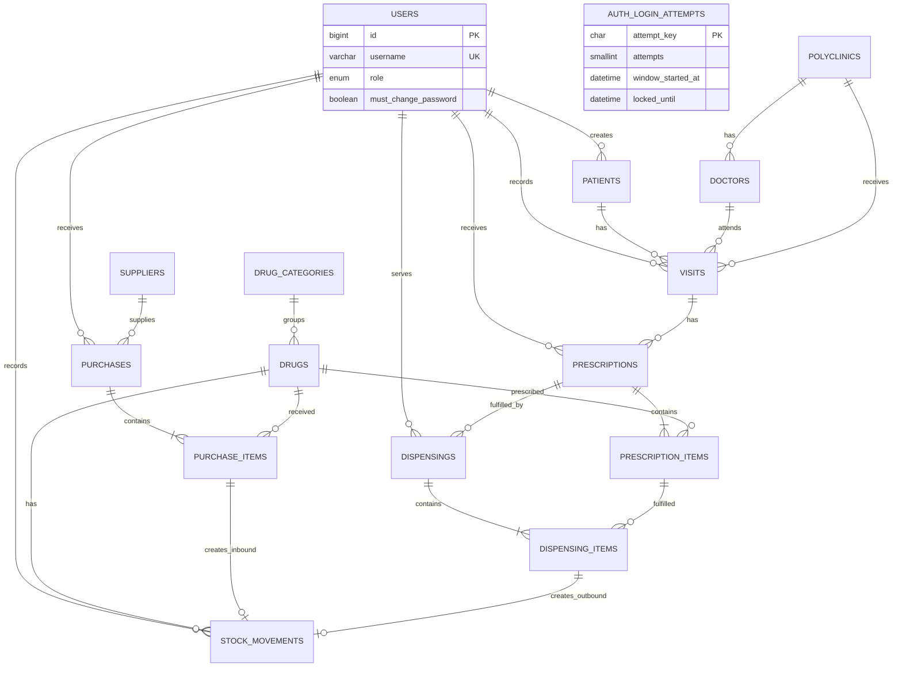

# EightMedi — ERD dan Desain Database v1.2

## Keputusan desain
- Sistem standalone berbasis PHP dan MySQL.
- 16 tabel pada versi aplikasi ini: 15 tabel operasional dan 1 tabel teknis pembatasan login.
- Satu stok terkini dan satu harga referensi pada setiap master obat.
- Setiap dokter memiliki satu poliklinik utama melalui `doctors.polyclinic_id`.
- Satu tanggal kedaluwarsa acuan per obat, bukan per batch.
- Pengadaan berupa penerimaan langsung tanpa Purchase Order.
- Satu resep dapat memiliki beberapa transaksi penyerahan.
- Setiap penerimaan dan penyerahan menghasilkan catatan `stock_movements`.

## ERD (Mermaid)

## Daftar tabel

| No. | Tabel | Peran |
|---:|---|---|
| 1 | `users` | Akun login dan pencatat aktivitas |
| 2 | `patients` | Identitas pasien dan nomor rekam medis |
| 3 | `polyclinics` | Master poliklinik |
| 4 | `doctors` | Master dokter dengan satu poliklinik utama (`polyclinic_id`) |
| 5 | `visits` | Riwayat kunjungan pasien |
| 6 | `drug_categories` | Kategori obat |
| 7 | `drugs` | Master obat, harga referensi, stok terkini, tanggal kedaluwarsa acuan |
| 8 | `prescriptions` | Header resep dari poli |
| 9 | `prescription_items` | Detail obat dalam resep |
| 10 | `dispensings` | Header transaksi penyerahan obat |
| 11 | `dispensing_items` | Detail jumlah yang benar-benar diserahkan |
| 12 | `suppliers` | Master pemasok |
| 13 | `purchases` | Header penerimaan langsung |
| 14 | `purchase_items` | Detail obat yang diterima |
| 15 | `stock_movements` | Buku besar pergerakan stok |
| 16 | `auth_login_attempts` | Pembatasan percobaan login (tabel teknis, tanpa menyimpan IP mentah) |

## Relasi penting

- `patients` 1:N `visits`.
- `polyclinics` 1:N `doctors` (satu dokter memiliki satu poliklinik utama).
- `polyclinics` 1:N `visits`.
- `doctors` 1:N `visits`.
- `visits` 1:N `prescriptions`.
- `prescriptions` 1:N `prescription_items`.
- `prescription_items` 1:N `dispensing_items`.
- `prescriptions` 1:N `dispensings`.
- `dispensings` 1:N `dispensing_items`.
- `suppliers` 1:N `purchases`.
- `purchases` 1:N `purchase_items`.
- `drugs` 1:N `purchase_items`, `prescription_items`, dan `stock_movements`.

## Aturan integritas yang harus dijalankan aplikasi

1. Nomor rekam medis, nomor kunjungan, nomor resep, nomor penerimaan, dan nomor penyerahan harus unik.
2. Jumlah yang diserahkan secara kumulatif tidak boleh melebihi jumlah yang diresepkan.
3. Stok tidak boleh negatif.
4. Penerimaan obat memperbarui `drugs.stock_qty` dan membuat satu movement `IN` dalam transaksi yang sama.
5. Penyerahan obat memperbarui `drugs.stock_qty` dan membuat satu movement `OUT` dalam transaksi yang sama.
6. `stock_movements` bersifat histori; jangan menghapus transaksi stok untuk memperbaiki kesalahan. Gunakan transaksi koreksi.
7. Status resep dihitung dari total penyerahan semua item resep, dengan mempertimbangkan status proses dan pembatalan.
8. Validasi bahwa `dispensing_items.prescription_item_id` berasal dari resep yang sama dengan `dispensings.prescription_id` harus dilakukan di backend.
9. Saat obat dinonaktifkan atau sudah memiliki transaksi, gunakan soft deactivation (`is_active=0`), bukan penghapusan fisik.

## Batasan versi 1.0

- Kedaluwarsa hanya satu tanggal acuan per obat. Sistem tidak dapat membedakan beberapa tanggal kedaluwarsa untuk stok obat yang sama.
- Penerimaan langsung dicatat tanpa Purchase Order.
- Harga referensi hanya satu nilai pada master obat. Detail penerimaan tidak menyimpan histori harga beli.
- Data poli dan resep dimasukkan melalui halaman simulasi, bukan integrasi API dengan SIMRS eksternal.

## Tabel teknis keamanan

`auth_login_attempts` menyimpan penghitung percobaan login dengan kunci SHA-256. Alamat IP mentah tidak disimpan. Baris lama dibersihkan otomatis saat ada percobaan login setelah lebih dari tujuh hari.

## Perubahan keamanan v1.2

- `users.role`: `ADMIN` atau `PETUGAS`.
- `users.must_change_password`: memaksa pengguna mengganti password sementara.
- `auth_login_attempts`: pembatasan login 5 percobaan per kombinasi akun+IP dan 20 percobaan per IP dalam jendela 15 menit.
- Semua pengguna tetap menggunakan modul operasional yang sama; hanya pengelolaan akun yang dibatasi untuk administrator.
